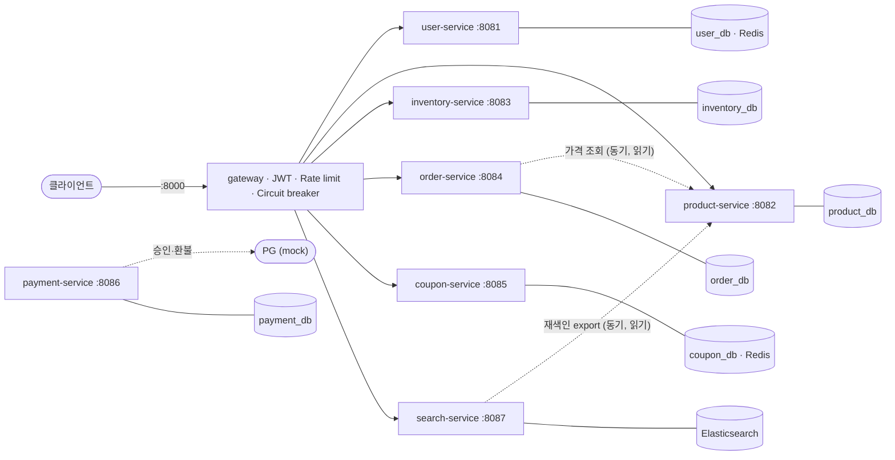
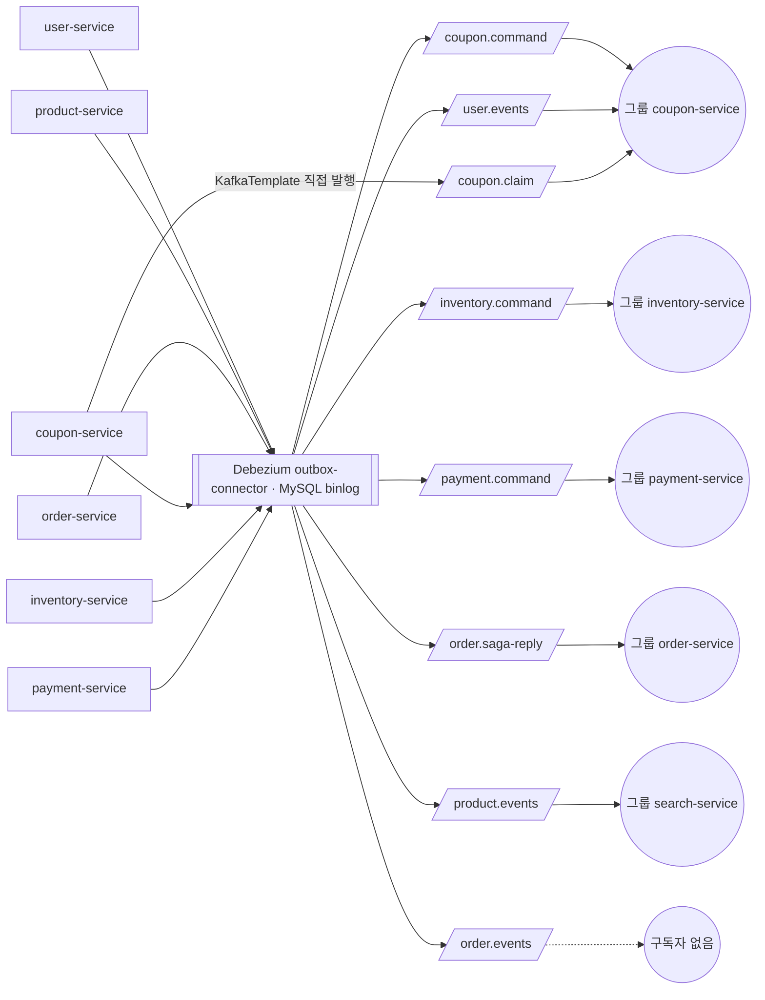
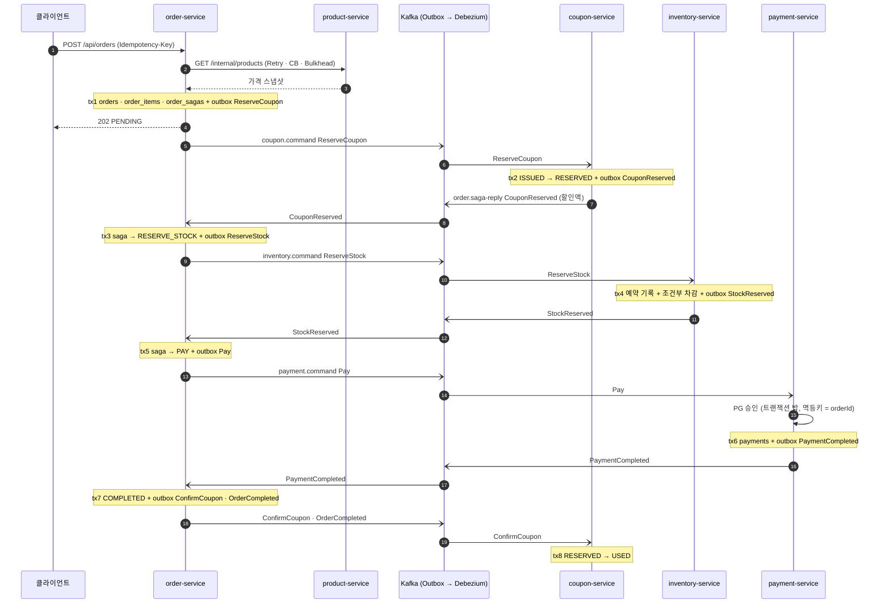
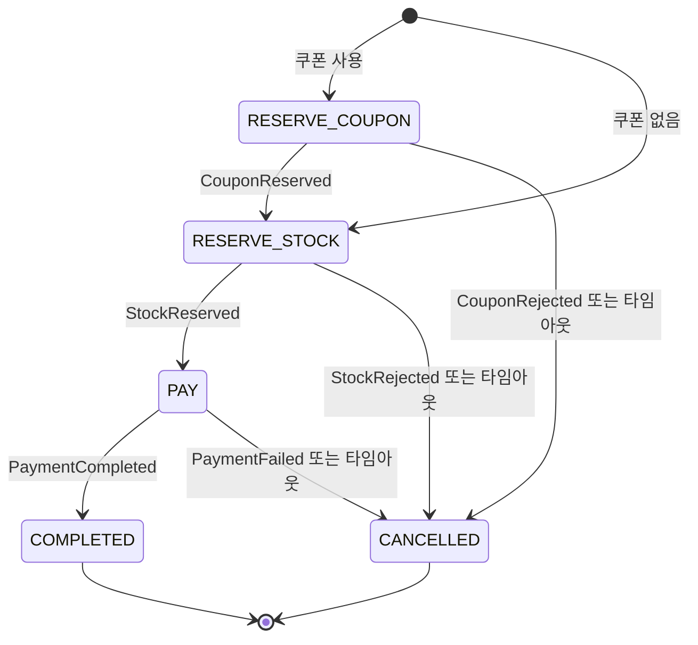
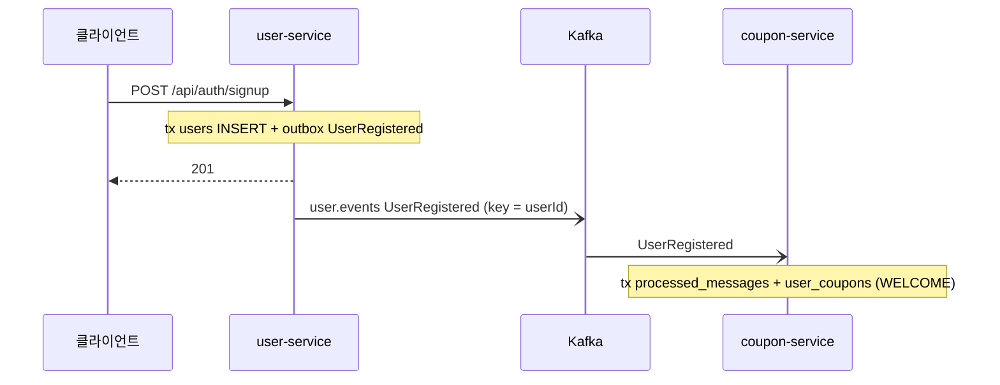
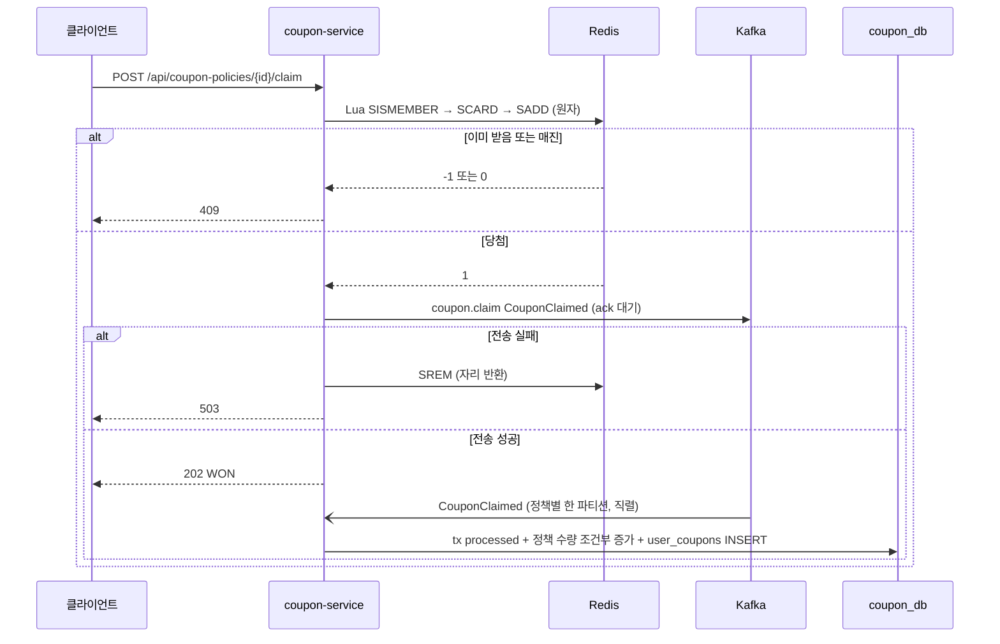
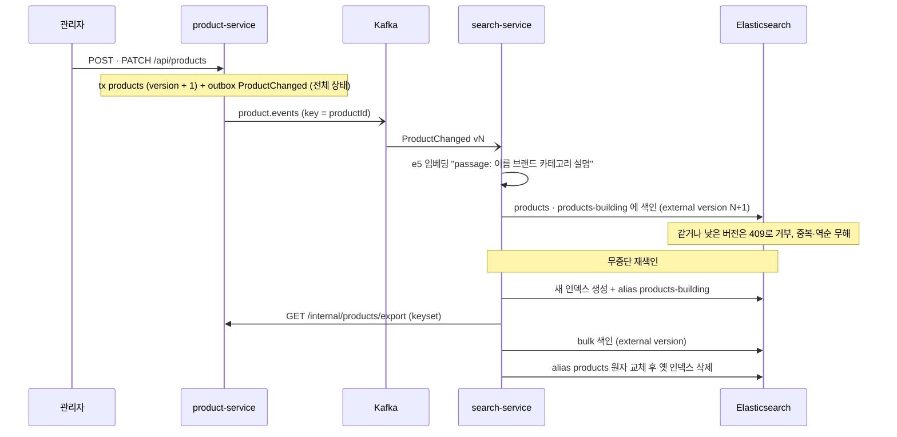
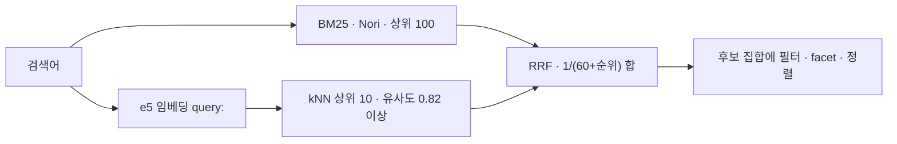

# 쇼핑몰 MSA 설계도

서비스 경계, 흐름별 트랜잭션, Kafka 토픽·파티션·컨슈머 그룹.

**기준** 2026-10-08 · main dd7ace6 · **서비스** 8개 + gateway · **토픽** 8개 × 파티션 3 · **컨슈머 그룹** 5개 · lag 0 · **테스트** 91개 + E2E 38개 · **ADR** 12건

## 목차

- [서비스 경계](#서비스-경계)
- [메시지 파이프라인](#메시지-파이프라인)
- [토픽과 파티션](#토픽과-파티션)
- [컨슈머 그룹](#컨슈머-그룹)
- [주문 Saga](#주문-Saga)
- [그 밖의 흐름](#그-밖의-흐름)
- [정합성 장치](#정합성-장치)
- [장애 격리와 관측성](#장애-격리와-관측성)
- [검증 수치](#검증-수치)

## 서비스 경계

각 서비스는 자기 데이터만 소유합니다. DB 계정을 서비스마다 분리해서 다른 서비스의 테이블은 권한상 읽을 수 없습니다. 외부 요청은 gateway 하나로만 들어옵니다.

*동기 호출과 데이터 소유. 점선은 서비스 간 동기 호출이며 둘 다 읽기 전용입니다.*

| 서비스 | 책임 | 소유 데이터 | 외부 API | 내부 API | 발행 | 구독 |
|---|---|---|---|---|---|---|
| gateway :8000 | JWT 검증(RS256, JWKS), 라우팅, Rate limit, Circuit breaker | Redis(rate limit 버킷) | 전체 진입점 | actuator :8090 | – | – |
| user-service | 회원, 로그인, 토큰 | user_db: `users` · Redis: refresh token(해시) | `/api/auth/**`, `/api/users/**` | `/.well-known/jwks.json` | `user.events` | – |
| product-service | 상품 카탈로그 | product_db: `products` | `/api/products/**` | `/internal/products`, `/internal/products/export` | `product.events` | – |
| inventory-service | 재고, 재고 예약 | inventory_db: `stocks`, `stock_reservations`, `released_orders` | `/api/inventory/**` | `/internal/loadtest/**` | `order.saga-reply` | `inventory.command` |
| order-service | 주문 접수, OrderSaga | order_db: `orders`, `order_items`, `order_sagas` | `/api/orders/**` | – | `*.command`, `order.events` | `order.saga-reply` |
| coupon-service | 쿠폰 정책, 발급, 예약 | coupon_db: `coupon_policies`, `user_coupons`, `released_orders` · Redis: 선착순 당첨자 집합 | `/api/coupon-policies/**`, `/api/coupons/**` | – | `order.saga-reply`, `coupon.claim` | `coupon.command`, `user.events`, `coupon.claim` |
| payment-service | 결제(Mock PG) | payment_db: `payments` | –(Kafka로만 호출) | – | `order.saga-reply` | `payment.command` |
| search-service | 검색 읽기 모델(CQRS) | Elasticsearch `products-*`(alias `products`) · 임베딩 모델 | `/api/search/**` | `/internal/search/reindex` | – | `product.events` |

> outbox가 있는 6개 DB(user, product, inventory, order, coupon, payment)에는 모두 `outbox`와 `processed_messages` 테이블이 함께 있습니다. 인프라: discovery-server(Eureka) :8761, config-server :8888.

- 데이터를 바꾸는 서비스 간 통신은 모두 Kafka(Outbox 경유)입니다. 동기 호출은 가격 조회와 재색인 export, 두 군데의 읽기뿐입니다.
- `/internal/**`에는 gateway 라우트가 없어서 외부에서 호출할 수 없습니다.
- gateway가 토큰을 검증한 뒤 `X-User-Id`, `X-User-Roles`를 붙이고, 클라이언트가 보낸 같은 헤더는 항상 지웁니다.

## 메시지 파이프라인

서비스는 Kafka에 직접 쓰지 않습니다. 비즈니스 변경과 같은 트랜잭션에서 자기 DB의 `outbox` 테이블에 행을 쓰고, Debezium이 binlog를 읽어 Kafka로 옮깁니다. 커넥터 하나가 6개 DB의 outbox를 모두 읽습니다. 예외는 선착순 쿠폰의 `coupon.claim` 하나로, 응답 전에 ack를 받는 직접 발행입니다.

*Outbox → Debezium → 토픽 → 컨슈머 그룹. `order.events`는 아직 구독자가 없습니다(알림 서비스 자리).*

| outbox 컬럼 | Kafka로 가는 곳 | 용도 |
|---|---|---|
| `id` | 헤더 `id` | 컨슈머의 중복 제거 키(`processed_messages`) |
| `aggregate_type` | 토픽 이름 | EventRouter가 이 값으로 라우팅 |
| `aggregate_id` | 메시지 키 | 파티션 결정. 같은 Saga나 상품의 메시지는 같은 파티션에서 순서대로 |
| `type` | 헤더 `type` | 컨슈머가 처리 방법을 고르는 값(예: `ReserveStock`) |
| `payload` | 메시지 값(JSON) | 메시지 본문 |
| `traceparent` | 헤더 `traceparent` | W3C trace context. Kafka를 건너도 트레이스가 이어짐 |
| `seq`, `created_at` | – | 삽입 순서와 정리용 |

## 토픽과 파티션

모든 업무 토픽은 파티션 3개, 복제 1입니다(로컬 단일 브로커). 순서는 키 단위로만 보장되므로, 순서가 필요한 단위를 키로 정했습니다.

| 토픽 | 키 | 발행 | 메시지 | 컨슈머 그룹 | 키가 보장하는 순서 |
|---|---|---|---|---|---|
| `coupon.command` | sagaId | order-service (Outbox) | ReserveCoupon · ConfirmCoupon · ReleaseCoupon | coupon-service | 한 주문의 예약 → 확정 또는 복구 |
| `inventory.command` | sagaId | order-service (Outbox) | ReserveStock · ReleaseStock | inventory-service | 예약 뒤에 복구 |
| `payment.command` | sagaId | order-service (Outbox) | Pay · CancelPayment | payment-service | 결제 뒤에 취소, 늦게 승인된 결제는 환불 |
| `order.saga-reply` | sagaId | coupon · inventory · payment (Outbox) | CouponReserved · CouponRejected · StockReserved · StockRejected · PaymentCompleted · PaymentFailed | order-service | 한 Saga의 응답이 도착 순서대로 |
| `user.events` | userId | user-service (Outbox) | UserRegistered | coupon-service | – |
| `product.events` | productId | product-service (Outbox) | ProductChanged (전체 상태 + version) | search-service | 같은 상품의 변경 순서(ES version으로 한 번 더 방어) |
| `order.events` | orderId | order-service (Outbox) | OrderCompleted · OrderCancelled | 없음 | – |
| `coupon.claim` | policyId | coupon-service (KafkaTemplate) | CouponClaimed | coupon-service | 한 정책의 저장이 한 파티션에서 직렬, 락 경합 없음 |

> 그 밖의 토픽: `cdc.schema-history`, `connect-configs` · `connect-offsets` · `connect-status`(Debezium). 재시도를 다 쓴 메시지는 `<토픽>.DLT`로 가며, 2026-10-08 기준 DLT는 0개입니다.

## 컨슈머 그룹

그룹 이름은 서비스 이름과 같습니다. 인스턴스가 늘면 파티션이 나뉘어 할당되므로 그룹당 최대 3대까지 병렬로 소비합니다. 지금은 인스턴스가 1대라 한 컨슈머가 모든 파티션을 맡습니다.

| 그룹 | 구독 토픽(파티션) | 중복 처리 | lag |
|---|---|---|---|
| coupon-service | `coupon.command`(3) · `user.events`(3) · `coupon.claim`(3) | `processed_messages`, 쿠폰 상태 조건부 UPDATE, UNIQUE(policy_id, user_id) | 0 |
| inventory-service | `inventory.command`(3) | `processed_messages`, orderId 예약 기록 | 0 |
| order-service | `order.saga-reply`(3) | `processed_messages`, Saga 단계 검사, `@Version` | 0 |
| payment-service | `payment.command`(3) | `processed_messages`, UNIQUE(order_id), PG 멱등키 | 0 |
| search-service | `product.events`(3) | ES external version(DB 없음) | 0 |

- 오프셋은 레코드마다, 핸들러의 DB 트랜잭션이 커밋된 뒤에 커밋합니다(`ack-mode: record`). 커밋 직후 죽으면 같은 메시지가 다시 오고, 중복 처리 장치가 막습니다.
- 실패한 메시지는 0.5초부터 2배씩, 최대 10초 동안 재시도한 뒤 DLT로 보냅니다. 형식이 잘못된 메시지는 곧바로 DLT로 갑니다.
- 새 그룹은 처음부터 읽습니다(`auto-offset-reset: earliest`). 리스너 observation이 켜져 있어 헤더의 traceparent로 트레이스를 이어 갑니다.

## 주문 Saga

OrderSaga가 쿠폰 → 재고 → 결제 순서로 명령을 보내는 오케스트레이션입니다. 실패할 가능성이 높고 되돌리기 쉬운 단계를 앞에, 되돌리기 어려운 결제를 맨 뒤에 둡니다. 각 화살표 사이의 작업은 한 서비스의 로컬 트랜잭션 하나입니다.

*정상 흐름. 메시지는 모두 Outbox → Debezium → Kafka를 거칩니다.*

| tx | 서비스 | 같은 트랜잭션에서 바뀌는 것 | 같은 트랜잭션의 outbox | 거절될 때 |
|---|---|---|---|---|
| 1 | order | `orders`(PENDING), `order_items`(가격 스냅샷), `order_sagas` | ReserveCoupon 또는 ReserveStock | 트랜잭션 전 가격 조회가 실패하면 주문 자체가 생기지 않음(400/503) |
| 2 | coupon | `processed_messages`, `user_coupons` ISSUED → RESERVED(조건부) | CouponReserved(할인액) | 새 트랜잭션: processed + CouponRejected |
| 3 | order | `processed_messages`, `order_sagas` → RESERVE_STOCK(`@Version`), `orders.discount_amount` | ReserveStock | – |
| 4 | inventory | `processed_messages`, `stock_reservations` INSERT, `stocks` 조건부 차감(productId 순서) | StockReserved | 새 트랜잭션: processed + StockRejected |
| 5 | order | `processed_messages`, `order_sagas` → PAY | Pay(총액 − 할인) | – |
| 6 | payment | PG 승인은 트랜잭션 밖. 그 뒤 `processed_messages`, `payments` INSERT | PaymentCompleted 또는 PaymentFailed | – |
| 7 | order | `processed_messages`, `orders` COMPLETED, `order_sagas` COMPLETED | ConfirmCoupon, OrderCompleted | – |
| 8 | coupon | `processed_messages`, `user_coupons` RESERVED → USED | – | – |

*Saga 상태. CANCELLED로 갈 때 이미 잡은 자원을 역순으로 되돌립니다.*

| 실패 지점 | 보내는 보상 | 받는 쪽에서 일어나는 일 | 보상이 원래 명령보다 먼저 도착하면 |
|---|---|---|---|
| CouponRejected | 없음 | – | – |
| StockRejected | ReleaseCoupon | RESERVED → ISSUED | coupon `released_orders`에 기록, 늦은 ReserveCoupon은 CANCELLED로 거절 |
| PaymentFailed | ReleaseStock, ReleaseCoupon | 예약 RESERVED → RELEASED(조건부) 후 재고 복구 | inventory `released_orders`에 기록, 늦은 ReserveStock 거절 |
| 결제 단계 타임아웃 | CancelPayment, ReleaseStock, ReleaseCoupon | 승인된 결제는 CANCELLED 후 환불 | payment에 CANCELLED 행을 먼저 기록, 늦은 Pay는 PG 호출 없이 거절 |

- 보상은 응답을 기다리지 않습니다. 보상은 멱등하고 Outbox와 재시도, DLT로 전달이 보장되므로, 응답을 기다려도 상태만 늘어날 뿐입니다.
- 타임아웃 잡: 2초마다 마감이 지난 Saga를 `FOR UPDATE SKIP LOCKED`로 잡습니다. 단계당 10초 동안 응답이 없으면 같은 명령을 다시 보내고(최대 3회), 그래도 없으면 응답이 없던 단계까지 포함해 보상합니다.
- 같은 Saga에 대한 응답 처리와 타임아웃 잡이 겹치면 `@Version`이 한쪽을 실패시키고, Kafka 재시도가 최신 상태로 다시 처리합니다.
- 늦게 오거나 중복된 응답은 현재 단계와 맞지 않으면 무시합니다. Saga를 포기할 때 이미 보상을 보냈기 때문입니다.

## 그 밖의 흐름

회원가입 축하 쿠폰은 코레오그래피입니다. user-service는 쿠폰이 지급된다는 사실을 모르고, 지급이 실패해도 가입은 되돌리지 않습니다.

*회원가입 → 축하 쿠폰.*

선착순 쿠폰은 요청 경로에 DB 트랜잭션이 없습니다. Redis가 원자적으로 당첨을 판정하고, DB 저장은 Kafka 뒤에서 정책별로 하나씩 처리합니다.

*선착순 쿠폰. Kafka 전송에 실패하면 Redis 자리를 되돌려 두 저장소가 어긋나지 않게 합니다.*

검색은 상품 DB와 분리된 읽기 모델입니다. 이벤트에 상품의 전체 상태와 version을 담고, version을 ES external version으로 써서 중복이나 순서 역전을 ES가 스스로 거부합니다. 그래서 search-service에는 DB가 없습니다.

*상품 변경 → 검색 반영, 그리고 무중단 재색인.*

*하이브리드 검색. ES의 RRF는 유료 라이선스라 애플리케이션 코드에서 합칩니다.*

## 정합성 장치

| 막으려는 문제 | 장치 | 위치 |
|---|---|---|
| DB 커밋과 메시지 발행이 어긋남 | Transactional Outbox + Debezium | 6개 서비스 |
| 같은 메시지가 두 번 옴 | `processed_messages`(INSERT IGNORE), ES external version | 모든 컨슈머 |
| 재고 초과 판매 | 조건부 UPDATE, productId 순서로 잠금, `CHECK(quantity >= 0)` | inventory |
| 쿠폰 이중 사용 | 상태 조건부 UPDATE(ISSUED → RESERVED) | coupon |
| 보상이 원래 명령을 앞지름 | `released_orders`, CANCELLED 행(tombstone) | inventory · coupon · payment |
| 이중 결제 | UNIQUE(order_id), PG 멱등키 = orderId | payment |
| 더블클릭 주문 | `Idempotency-Key` + UNIQUE(user_id, idempotency_key) | order |
| 응답과 타임아웃 잡의 경합 | `@Version`, `FOR UPDATE SKIP LOCKED` | order |
| 메시지 순서 역전 | 파티션 키(sagaId, productId), 이벤트 version | Kafka · search |
| 선착순 수량 초과 | Redis Lua 원자 판정, DB `CHECK(issued <= total)` | coupon |
| 쿠폰 발급 데드락(FK 공유 락) | 정책 행 UPDATE를 INSERT보다 먼저 | coupon |

## 장애 격리와 관측성

| 항목 | 설정 | 근거 |
|---|---|---|
| 타임아웃 예산 | product 조회 1초 × 2회 + 0.1초 < gateway 5초 | 안쪽이 길면 gateway가 먼저 포기함(troubleshooting #9) |
| 재시도 계층 | Resilience4j 한 곳만. LoadBalancer 재시도 끔 | spring-retry가 자동으로 켜서 호출이 4배가 됨(#10) |
| Circuit breaker | order → product, gateway 라우트마다 | product 정지 시 2.14초 → 0.01초 실패 |
| Rate limit | 로그인: IP당 버스트 10 · 초당 1 / 주문: 사용자당 버스트 10 · 초당 5 | Redis 토큰 버킷, gateway 여러 대가 공유 |
| 트레이스 | Micrometer → OTel → Zipkin, outbox `traceparent` | 주문 하나가 6개 서비스, span 16개의 한 트레이스 |
| 메트릭 | Prometheus(Eureka로 대상 자동 발견) → Grafana | 주문 결과·취소 사유, Saga 진행 중 건수, Circuit 상태, consumer lag |
| 로그 | loki4j → Loki, 모든 줄에 traceId | Grafana에서 로그를 누르면 트레이스로 이동 |

## 검증 수치

| 시나리오 | 결과 | 재현 |
|---|---|---|
| Debezium 정지 중 주문 | 메시지가 outbox에 남아 있다가 재기동 후 COMPLETED(유실 0) | `scripts/demo-failures.sh` |
| inventory 35초 정지 | 재전송 2회 후 보상, 재고 8 → 8 그대로 | `scripts/demo-failures.sh` |
| 인기 상품 재고 3,000 · 요청 20,000 | 4가지 방식 모두 초과판매 0. Redis 게이트 5,624 rps, 조건부 UPDATE 3,489 rps | `load-test/run.sh` |
| 선착순 쿠폰 1,000장 · 요청 10,000 | 정확히 1,000장, 1인 1매. Redis 7,906 rps, DB 2,457 rps | `load-test/run.sh` |
| 재색인 중 검색과 상품 수정 | 검색 56건 모두 200, 마지막 가격 유지 | `scripts/demo-reindex.sh` |
| 하이브리드 검색(질의 21개) | 의도 검색 Recall@5 0 → 0.53(하한선 0.82), 정확 검색 1.00 유지, p50 19ms | `search-eval/evaluate.py` |

> 측정 환경은 M3 Pro 노트북의 Docker(CPU 3개, 메모리 9.7GB)이고, 서비스·인프라·k6가 모두 그 안에서 함께 돌았습니다. 절대값보다 같은 환경에서의 상대 비교로 읽어야 합니다. 설계 이유는 `docs/adr/0001~0012`, 겪은 문제 18건은 `docs/troubleshooting.md`에 있습니다.
